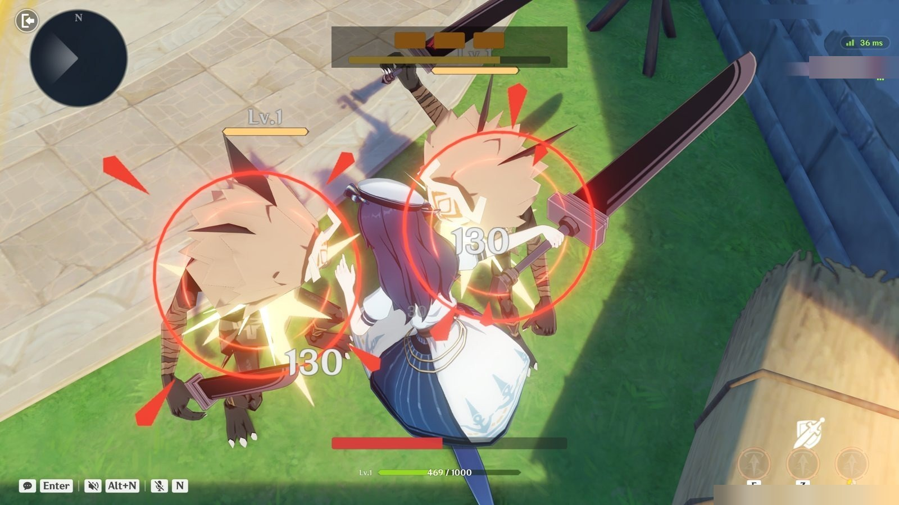
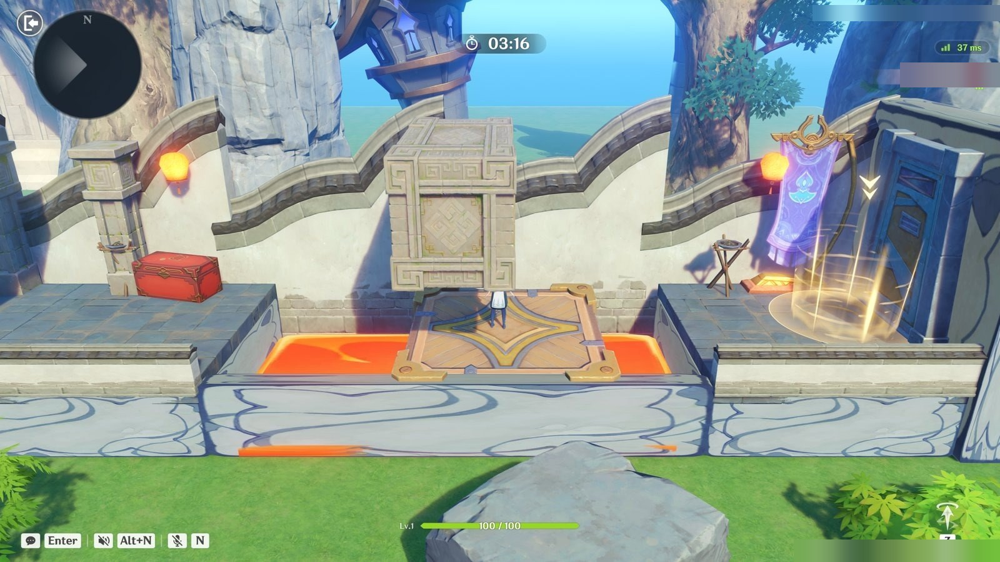
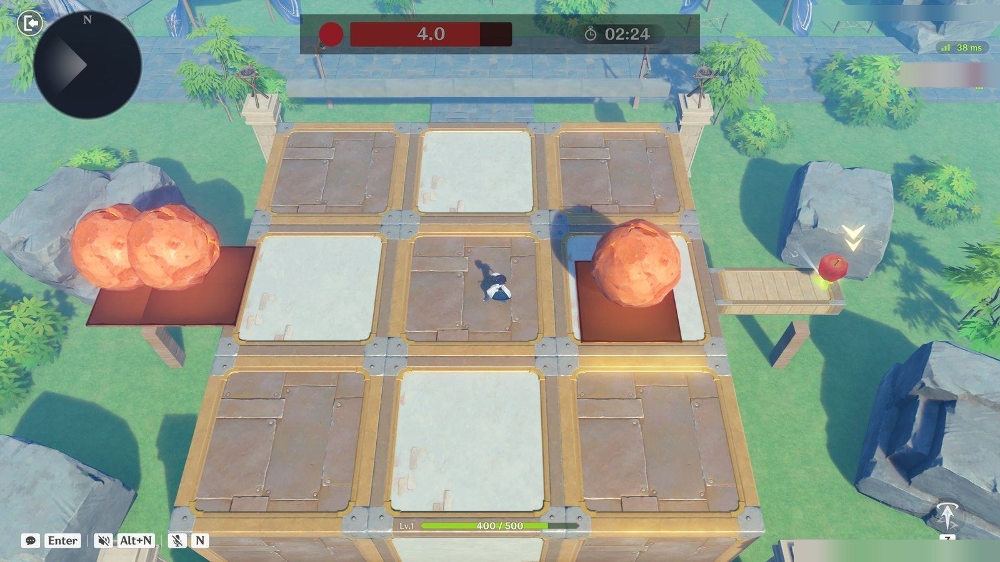
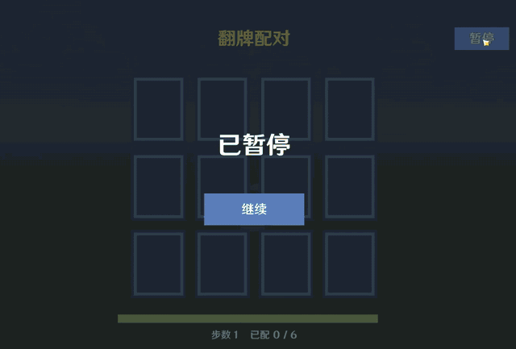
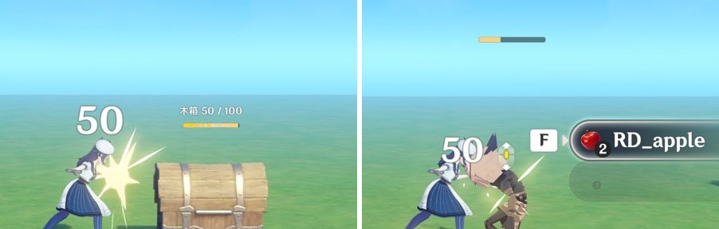
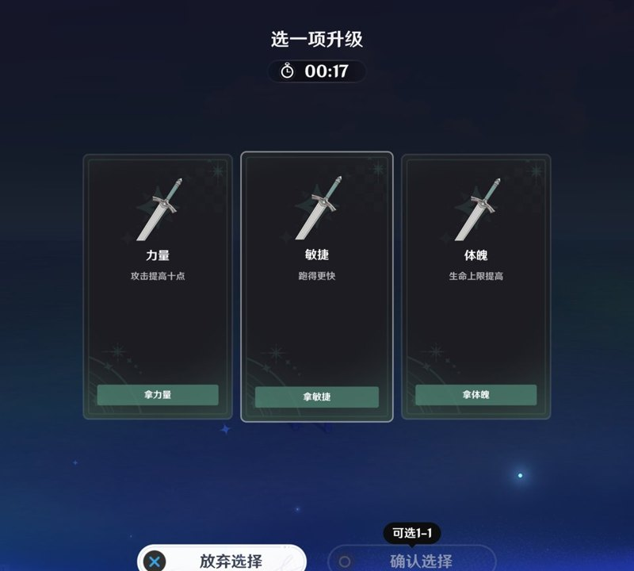
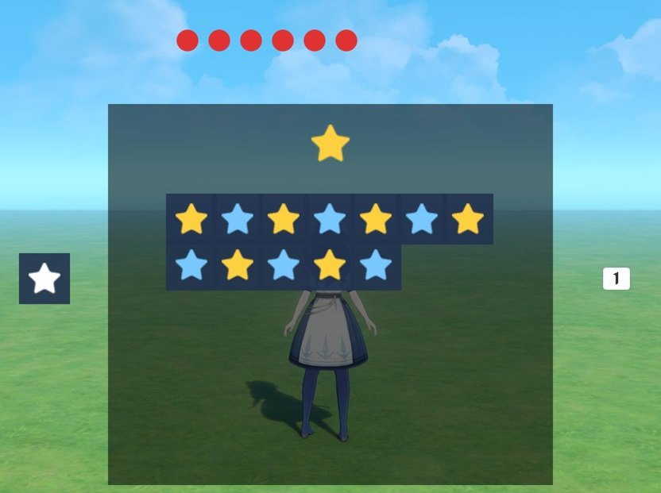
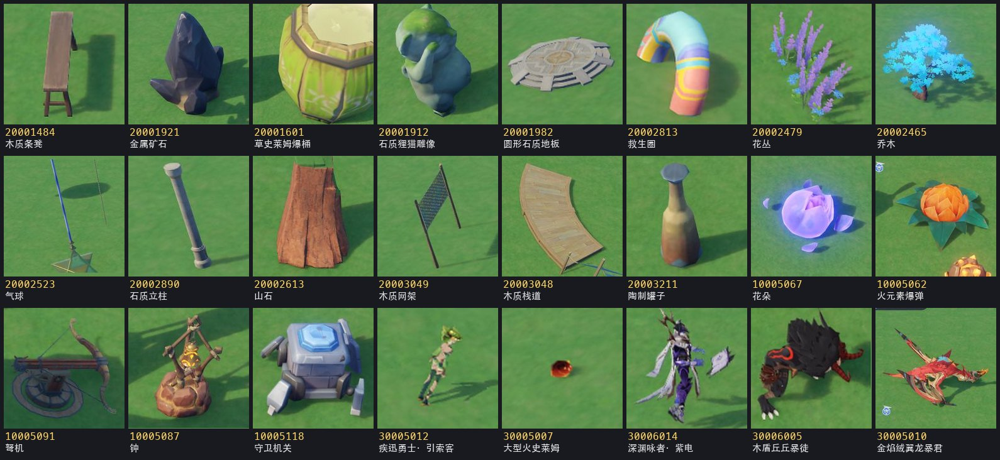
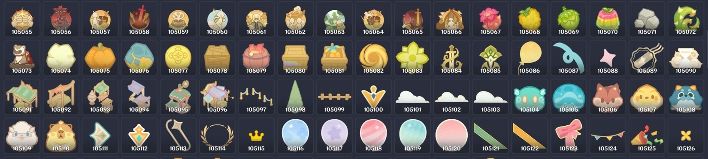

# genshin-miliastra-mcp · 原神千星奇域游戏制作 MCP 服务器

**让 AI 替你做千星奇域的关卡。** Miliastra Wonderland MCP Server for Genshin Impact UGC · [English](README.en.md)

给支持 MCP（Model Context Protocol）的 AI 用的《原神》千星奇域创作工具。你在自己的电脑上开着千星奇域的编辑器（千星沙箱），Claude、Cursor、Codex 这类 AI 接上这套工具替你搭关卡：搜物件摆场景、设关卡、写节点图（TypeScript，用 **Genshin-TS 0.2.2** 编译）、自动试玩并拿回日志和截图。

| | | |
|---|---|---|
|  |  |  |

上面三局是三个没参与过开发的 AI 各自只拿到这套工具、从空白地图做出来并按脚本打通的（[经过和它们卡在哪](docs/BLIND_TEST_2026-10-13.zh-CN.md)）。

**AI 自己进游戏试玩。** 下面这段是工具录的：一局用客户端 Lua 写的翻牌配对（[examples/pairs](examples/pairs)），工具把它写进存档、打开游戏、照脚本点暂停、继续、翻完十二张牌，一直打到游戏自己的胜利画面，再把日志和画面拿回来对照。没有人碰鼠标。



## 它能做什么

- **搭场景**：2468 种官方物件的图鉴，按名字搜、看缩略图，一次导入一百个物件；锁定视角、出生点、复苏点、昼夜和灯光。
- **做机关和怪**：元件、碰撞触发器、按 F 交互、移动平台、弹跳垫、力场、隐形墙、投射物和命中检测、会自己找敌人打的复杂造物、技能、道具、商店、货币；NPC 头顶的对话气泡、名字、血条。

  | | |
  |---|---|
  |  |  |

- **做界面**：进度条（横条、竖条、圆环）、图片（约 1600 张平台自带的图）、计时器、按钮、卡牌选择器（三选一）。

  

- **写客户端 Lua**（游戏 7.1 的新能力）：会动、能收鼠标和按键的界面，甚至整局 2D 小游戏；脚本的打印和节点图的打印一起从试玩里拿回来。

  

- **写规则**：节点图用 TypeScript 写，一次编译几十张图写进存档；自带节点文档、特效（3195 条）、音效（1997 条）、音乐（188 条）的中文目录。
- **自己试玩**：按脚本按键、点鼠标、把玩家放到指定位置，截图、连拍、录音、录像，读回日志；AI 靠这个知道做出来的东西在游戏里到底对不对。
- **发布前的准备**：出封面、截图、标题和简介。发布本身由你在游戏里点。
- **离线知识库**：官方综合指南、教程、48 份官方教学存档的拆解，加上一份实测出来的平台规则，AI 设计玩法前先查。

## 自带的图鉴：缩略图和编号

千星奇域里的物件、特效、音效、图片，在存档和节点图里都是靠编号引用的。编号在编辑器里看得到，但本地数据里没有现成的表可查。这个仓库把它们整理成了图鉴，大部分是从编辑器里一样一样读出来、拍下来的，AI 按中文名字就能查到编号、看到长相再挑：



| 图鉴 | 数量 | 内容 | 文件 |
|---|---|---|---|
| 物件 | 2468 种，其中 2398 种有缩略图 | 编号、名字、分组、尺寸（名单和尺寸来自 [qianxing-format-docs](https://github.com/hang-ZYM/qianxing-format-docs)，CC BY 4.0）；缩略图是摆进编辑器里逐个实拍的 | `src/scene/asset-catalog.json`、`src/scene/thumbs/<编号>.jpg` |
| 特效 | 3195 条（限时 1986、循环 1209） | 编号、名字、每条在资产库里的小图；87 个循环特效另有挂在角色身上的实拍 | `src/scene/media/effects.json`、`fx-thumbs.*`、`src/scene/fx/` |
| 音效 | 1997 条 | 编号、名字、分类；其中 73 条录下来量过时长和响度 | `src/scene/media/sounds.json` |
| 背景音乐 | 188 首 | 编号、名字、分类 | `src/scene/media/music.json` |
| 界面图片 | 1590 张，15 类 | 图标、底板、分隔线、技能、道具、造物头像等；图库逐页的照片，每张图下面标着编号 | `src/scene/image-library/` |
| 复杂造物的动画 | 18 种造物 296 条 | 名字、编号、时长、是否循环；逐帧看过的动作写了手里拿什么、哪一毫秒出手 | `src/scene/media/creature-animations.json` |
| 机关的预设状态 | 45 个机关 | 宝箱开合、拉杆、活板门这些状态的编号和取值 | `src/scene/preset-status.json` |
| 官方教学存档 | 48 份 | 逐份拆成 JSON，加上做法的归纳 | `knowledge/samples/` |



这些都是普通的 JSON 和 JPG，不接 MCP 也可以直接拿去用（比如手写 Genshin-TS 时查编号）。游戏更新后重新抄一遍的办法在 `scripts/dev/README.md`。

## 说明和现状

**这是爱好者做的非官方项目**，和米哈游 / HoYoverse 没有关系。它只读写你本机的千星奇域存档、像人一样操作你自己打开的编辑器窗口，不修改游戏程序，不读写游戏内存，不拦截网络。游戏更新以后存档格式或界面可能变，工具要跟着改。用之前请自己确认符合游戏的用户协议和千星奇域的创作规范。

当前是 **0.1.0 预览版**：只在 Windows、国服中文客户端上验证过。

从哪看起：[现状和限制](docs/STATUS.zh-CN.md) · [平台规则](docs/PLATFORM_RULES.zh-CN.md)（实测出来的坑）· [千星奇域是怎么搭游戏的](docs/HOW_MILIASTRA_BUILDS_GAMES.zh-CN.md) · [范例](examples/README.zh-CN.md)。接上服务器以后，资源 `miliastra://workflow` 讲每一步用哪个工具，AI 会自己读。

## 需要什么

- Windows 10 或 11，装着原神（中文客户端），账号能进千星奇域的编辑器（千星沙箱）。
- Node.js **22.12 或更高**。
- Python 3.10 或更高。自动试玩和截图还要 `pip install -r requirements-capture.txt`（Pillow 和 rapidocr-onnxruntime）。
- 一个支持 stdio MCP 的 AI 客户端（Claude Code、Claude Desktop、Cursor、Codex CLI 等）。本服务自己不调用大模型，不需要 API Key。
- 试玩时显示器要开着（没有显示器游戏出不了画面），窗口 16:9 全屏；工具会占用鼠标和键盘，这段时间别同时操作电脑。

## 安装

```powershell
git clone https://github.com/8itlab/genshin-miliastra-mcp.git
cd genshin-miliastra-mcp
npm ci
npm run build:core
pip install -r requirements-capture.txt
npm run doctor
```

`npm run doctor` 检查 Node、Python 和可选的截图依赖是不是齐了。

## 接到 AI 客户端

在客户端的 MCP 配置里加一项（把路径换成你自己的；`examples/mcp.example.json` 是同一份）：

```json
{
  "mcpServers": {
    "miliastra": {
      "command": "node",
      "args": ["C:/path/to/genshin-miliastra-mcp/src/server.mjs"],
      "env": {
        "MILIASTRA_WORKSPACE": "C:/path/to/genshin-miliastra-mcp/workspace",
        "MILIASTRA_ALLOW_LIVE_WRITE": "0"
      }
    }
  }
}
```

Claude Code 可以用一条命令加：

```powershell
claude mcp add miliastra -e MILIASTRA_WORKSPACE=C:/path/to/genshin-miliastra-mcp/workspace -e MILIASTRA_ALLOW_LIVE_WRITE=0 -- node C:/path/to/genshin-miliastra-mcp/src/server.mjs
```

- `MILIASTRA_WORKSPACE`：工具放项目副本、截图和日志的文件夹。
- `MILIASTRA_ALLOW_LIVE_WRITE`：`0` 时只写存档的副本（试玩时再导入成一份新存档），不动你的正式存档。
- `MILIASTRA_PYTHON` / `MILIASTRA_PLAYTEST_PYTHON`：Python 不在 PATH 里，或者想用单独的环境时填解释器的绝对路径。
- `MILIASTRA_SAVE_ROOTS`：存档不在默认位置时填（绝对路径数组的 JSON 字符串）。默认从当前 Windows 用户的 `AppData/LocalLow/miHoYo/原神/BeyondLocal` 和国际服对应目录找，只扫账号下的 `Beyond_Local_Save_Level`。

服务用 stdio 说话，不是网页。多个客户端可以同时连同一个工作区（配置要一样）；它们共用一个后台进程，全部断开后自己退出。运行时的凭据在当前用户的 `LocalAppData/MiliastraMCP/runtime/`，不要把里面的 `core.json` 发给别人。

**如果你是替用户安装的 AI**：照上面“安装”的六条命令做，把 MCP 配置里的两处路径换成克隆下来的实际位置，让用户重启客户端；接上以后先读资源 `miliastra://workflow` 和 `miliastra://platform-rules` 再动手。仓库根目录的 [`llms.txt`](llms.txt) 是给你看的摘要。

## 第一次用

1. 在游戏里“我的奇域 → 新建存档”（超限模式），进编辑器存一次，记住存档名。
2. 对 AI 说类似这样的话：

> 使用 miliastra MCP。先读资源 `miliastra://workflow` 和 `miliastra://platform-rules`。在我的空白存档「XXX」上做一个一分钟的小游戏：捡齐五个金币就赢，倒计时走完就输。做完用 `playtest_start` 按脚本各打一遍赢和输，把结算画面的截图给我看；分别告诉我哪些是编译通过、哪些是在游戏里真的验证过的。

AI 做出来的东西写在存档的副本里；试玩时工具把副本导入成一份新存档并打开。发布由你自己在游戏里点，工具不点。

玩法代码是 Genshin-TS 支持的 TypeScript 子集；物件、特效、音效的编号都从工具自带的图鉴里查，不用自己找。

## 工具

| 工具 | 作用 |
|---|---|
| `get_capabilities` | 版本、功能、限制、路径、写入开关 |
| `list_maps` / `inspect_map` | 存档发现、真实图 ID、名称、类型、节点数；同名的存档会标出来 |
| `search_node_docs` | 搜索依赖自带的中英文节点定义（`queries` 一次查多个词） |
| `effect_catalog` / `sound_catalog` / `music_catalog` | 平台自带的特效（限时 1986、循环 1209）、音效（1997）、背景音乐（188）：按中文名字查编号，特效带缩略图，结果里有节点图里的用法。名字和编号是从编辑器的资产库里抄下来的 |
| `scene_search_assets` / `scene_asset_images` | 2468 种官方物件的图鉴：按名字查（`queries` 一次查多个词，查不到会给相近的名字）、按编号看缩略图 |
| `scene_add_prefab` / `scene_update_prefab` / `scene_list_prefabs` | 做元件（图里 `createPrefab` 造出来的东西）：物件、由摆好的怪做成的造物、掉落物（`drop`）；机关物件带预设状态（宝箱开合、拉杆、活板门，45 个已对上），`health` 定生命值；`scene_update_prefab` 改已有元件的缩放、模型、生命值，编号、组件和挂的图都不变 |
| `scene_add_components` / `scene_list_components` | 给元件加平台自带的组件：碰撞触发器、选项卡（按 F 交互，可带布尔过滤器）、自定义变量、基础运动器（直线、路径）、跟随运动器、小地图标识、文本气泡（NPC 头顶一句接一句的话）、铭牌（头顶的名字、图标、跟着变量走的条、血条，以及离远了指路的导航指示器）、自定义挂接点、受击盒、能力单元、弹射器（`launcher`：碰到的角色被弹出去，弹跳垫、推人的机关）、战利品、投射运动器（直线、抛物线、追踪目标）和命中检测（子弹；可只碰敌对阵营、可开连续碰撞检测）。范例 `examples/events` |
| `scene_add_graph` | 新建一张空图并挂好：关卡实体、元件（可一图挂多个元件）、玩家模板、角色模板；也能建客户端的技能图、过滤器图和道具图 |
| `scene_add_signal` / `scene_list_signals` | 信号（全关卡广播），可带好几个参数：整数、浮点数、布尔值、字符串、三维向量、实体、GUID、元件 ID、配置 ID 和它们的列表（编辑器给的十八种类型）；节点图之间、Lua 脚本发给节点图、节点图发给 Lua 脚本、客户端节点图发给服务器四条路都上机验过（`examples/signalparams`、`examples/brain`） |
| `scene_add_global_timer` / `scene_list_global_timers` / `scene_add_timer_display` | 全局计时器（倒计时或正计时）和屏幕上显示它的计时器控件 |
| `scene_add_creature_skill` / `scene_list_creature_skills` / `scene_set_creature_logic` | 复杂造物（“怪物(AI版)”那 48 种）：定义造物技能（一段或几段动画加一张技能图，可设自动面向目标），给造物元件绑上决策图和技能表（每个技能的冷却），设它多远发现敌人、多远放弃、领地多大。配合三种造物图（`scene_add_graph` 的 `creatureDecision` / `creatureStatus` / `creatureSkill`），单位就能按图走位、闲逛、干活、自己发现敌人、追上去打。做法见 `knowledge/notes/complex-creatures.zh-CN.md`，范例 `examples/brain`、`examples/skirmish`，整个游戏见 `examples/kingdom6` |
| `creature_animations` | 复杂造物的动画表：名字、编号、时长、是否循环（读了 18 种 296 条）。造物技能按名字或编号选动画。造物的模型都是空手的：表里还写了每种造物手里能拿什么、上机逐帧看过的那些动作是什么样、哪一毫秒算数（`atMs`，直接当技能的 `graphAtMs`） |
| `scene_add_skill` / `scene_list_skills` | 技能：瞬发，或带一段角色动画的普通技能（可在某一毫秒触发技能图、手里挂武器）；技能图里打攻击盒就能打到怪和带受击盒的物件 |
| `scene_add_currency` / `scene_list_currencies` | 货币，以及角色身上的背包 |
| `scene_add_item` / `scene_add_shop` / `scene_list_items` | 道具（材料，或带道具节点图、能在背包里使用的消耗品）；把元件做成商店（平台自带的买卖界面） |
| `scene_add_progress_bar` / `scene_add_button` / `scene_add_image` / `scene_list_interface` | 屏幕上的进度条（跟着玩家变量走；可以是横条、竖条、圆环，可以直接显示当前值的数字，颜色可改）、交互按钮（按数字键触发，玩家模板上的图收事件）和图片（平台自带的图，或一块纯色的底板：不靠文字也能把话说清楚）；控件可以一开始隐藏，由节点图开关 |
| `scene_add_text_box` | 屏幕上的文本框：文字，或跟着自定义变量走的数字（“金币：{1:ps.coins}”）。要奇匠 Lv.2 以上的账号才显示 |
| `scene_add_card_selector` | 卡牌选择器：平台自带的“几选一”窗口（每张卡有图标、标题、描述；单人关卡里打开时游戏暂停），节点图用 `f.invokeDeckSelector` 唤起、玩家模板上的图收到选了哪张。记录和官方样例“卡牌选择器”逐字节相同 |
| `scene_add_unit_status` / `scene_list_unit_statuses` | 单位状态：描边、透视、加生命上限；图里加减 |
| `scene_add_environment` / `scene_list_environments` / `scene_add_light` | 固定时刻的环境配置（昼夜靠两套配置切换；按编辑器的写法写，白天不会过曝）和属于某套配置的点光源 |
| `scene_set_client_script` / `scene_add_client_ui` / `scene_add_client_template` / `scene_remove_client` / `scene_list_client_scripts` | 客户端界面（游戏 7.1）：把 Lua 5.3 脚本放进存档，在屏幕上摆一棵由它控制的客户端控件树（十一种：图片、光标检测区域、容器、网格视窗、模板引用、预设按钮、按键提示、文本框等），还能做脚本运行时照着造的控件模板。界面可以每帧在动、收鼠标和按键，整局 2D 玩法也能做；和节点图靠自定义变量和信号互通（节点图也能直接给脚本发信号：`f.sendSignal('client:名字', 玩家)`）。脚本变量二十种类型都能定，同一个脚本挂在几个控件上可以各给各的值；控件能按设备（电脑、手机、主机）给不同的位置，能指定手柄摇杆往哪走。图片能直接带填充（横、竖、四分之一圈、半圈、整圈）、边缘羽化和遮罩反转，进度条和冷却圈不用脚本画；`scene_get_client_ui` 把已有的界面读回成参数，改完 `replace: true` 原位换回去。做法见 `knowledge/notes/client-lua.zh-CN.md`，脚本写进存档时当场查：语法错直接拒绝并给出行列，写死的控件名、信号名、变量名、接口名、图片和音效编号逐个对存档、节点图和图鉴（`scene_check_client`），对不上的给出行号和最接近的名字；运行时的错带着调用栈从试玩日志里回来。只改 Lua 的一轮不重新导入存档，真机上大约一分钟一轮。`editor_preview_interface` 让编辑器把界面画在手机、主机的画布上各截一张；`scene_import_simulator` 把千星沙箱模拟器的工程整个写进存档上真机。范例 `examples/clientui`、`examples/clientgame`、`examples/clientlist`、`examples/clientmenu`、`examples/clientcheck`、`examples/clientvars`、`examples/clientsignal`、`examples/clientapi`、`examples/clienttext`，以及整局游戏 `examples/pairs` |
| `image_catalog` | 界面图片控件能用的全部图片（约 1600 张，15 类：功能图标、玩法图标、装饰图案、底板、分隔线、特殊字符、技能、道具、造物头像）：按分类返回编辑器图库的照片，每张图下面是编号 |
| `scene_remove_entities` | 把已经导入场景的物件从存档副本里拿掉（按名字或名字前缀）：导入只能加，摆错的靠它减 |
| `scene_list_classes` / `scene_set_class` | 职业：角色能不能跳、冲刺、攀爬、滑翔，用哪个镜头模板；角色的等级和基础生命、攻击、防御、体力（新地图默认一万血，打不死） |
| `scene_set_spawn` / `scene_add_preset_point` / `scene_list_preset_points` | 出生点和图里按编号读取的命名位置 |
| `scene_add_respawn_point` / `scene_list_respawn_points` / `scene_set_revive` / `scene_set_player_count` | 复苏点（角色倒下后回来的地方；配合图里的激活复苏点做存档点）；复苏的规则：等几秒、自动复苏还是弹复苏界面、几条命、回来时几成血；关卡收几个人（发布单人游戏要设成 1 到 1） |
| `playtest_start` / `playtest_status` | 一键试玩：导入存档、订阅日志、按脚本按键 / 点鼠标 / 点屏幕上的字、截图（可以隔零点几秒连拍，`screenshotWidth` 调大留细节）、读屏幕文字、收日志；`recordAudio` 把这一局的声音录下来，报告每秒的响度和每个声音开始的时刻；`bakeNavigation` 试玩前在编辑器里烘焙寻路网格（复杂造物的闲逛、追击需要）。电脑的显示器要开着，没有显示器时游戏出不了画面，工具会直接报出来。输入里的 `teleport` 把玩家放到指定位置（每次之后报人到没到）、`trackPlayer` 记录玩家的位置并把每条打印换算成试玩秒数（往存档副本里加一个小探针）；`startValues` 给自定义变量另设这一轮的初值（从关卡后半段开始验）；同一份存档接着玩会跳过导入；`playtest_status` 的 `waitSeconds` 等到这一轮结束再回话；`recordVideo` 用系统的 Xbox Game Bar 录一段视频 |
| `playtest_frames` | 把一次试玩里某一段的截图裁到同一块区域、标上秒数、拼成一张图：逐帧看动作（武器在不在手上、落刀和伤害数字对不对得上、飞刀是不是手松开时出去的）。打印看不出这些 |
| `publish_kit` | 发布前的准备：从试玩截图里出封面和四张图（1600×900）、标题、描述、标签和一张对照官方要求的检查表，放进一个文件夹。真正的发布由创作者自己在游戏里做 |
| `search_knowledge` / `read_knowledge` | 离线搜索官方综合指南、教程、常见问题、48 份官方教学存档的拆解和教学视频文字稿（`knowledge/`）；总结见 [千星奇域是怎么搭游戏的](docs/HOW_MILIASTRA_BUILDS_GAMES.zh-CN.md) |
| `scene_get_level_settings` | 读关卡设置：仇恨类型、仇恨转移倍率、关卡时钟的起始时刻和流速（改用 `scene_set_level_settings`，见下面“搭场景”） |
| `scene_batch` | 一次调用里依次做一串 `scene_*` 改动，每一步用上一步返回的存档，后面的步骤能引用前面返回的编号；哪一步失败就停在哪一步并说明原因 |
| `write_graphs` | 写节点图：一次调用把一张或多张图的源码类型检查、编译、写进存档副本（三十七张图约二十秒），返回可以试玩的存档和每张图的节点数；哪张编译不过就停在哪张并报出错误；只改了几张就只发那几张。早先分五步做的那组工具（建项目、改源码、构建、预览、写入）默认不再列出，要用时设环境变量 `MILIASTRA_STEP_TOOLS=1` |
| `list_editor_windows` | 枚举原神与千星沙箱窗口、实际窗口 ID 和坐标 |
| `capture_editor_window` | 返回 MCP 内联 PNG、原图文件、缩放比例和质量提示 |
| `focus_editor_window` | 将指定编辑器窗口置于前台并返回新截图 |
| `editor_input` | 基于截图执行一次点击、按键、文字、滚动或拖拽，再返回新截图 |

资源 `miliastra://workflow` 提供面向 AI 的工作流与限制说明；`miliastra://knowledge` 是知识库的总结和索引。

上表里的工具哪些在游戏里走通过、还有哪些限制，见 [现状和限制](docs/STATUS.zh-CN.md)。用它们从零搭出并按脚本走通的游戏和一批单项验证关在 `examples/`。

## 一键试玩

写完代码、构建出候选存档后，用 `playtest_start` 让它自己玩一遍，再用 `playtest_status` 取结果。中间不需要 AI 一步步点界面。

```json
{
  "mapPath": "D:\\\\work\\\\candidate.gil",
  "graphName": "_GSTS_MyGraph",
  "durationSeconds": 120,
  "screenshotsAt": [10, 60, 110],
  "inputs": [{"at": 30, "key": "D", "holdMs": 3000}]
}
```

它会依次做：导入这个存档（生成一个新的官方存档）、打开并保存、在沙箱日志窗口订阅 `graphName`、开始试玩、按时间点截图和按键、到时间后退出试玩、取回这一场的官方日志。`playtest_status` 返回每一步的进度、日志里的打印（`t` 是关卡时钟的秒数）和截图。不传 `mapPath` 就直接试玩编辑器里已经打开的存档。

使用条件：

- 原神开着就行：停在主世界、千星奇域大厅、存档列表或编辑器里都可以，工具会自己走到存档列表。运行期间它会占用鼠标和键盘，不要同时操作这台电脑。
- 中文客户端。按钮靠识别界面文字来找，不依赖分辨率；只有左上角菜单和左下角退出两个纯图标按钮按窗口比例定位，目前只在 16:9 全屏下测过。
- Python 需要 `pip install -r requirements-capture.txt`（Pillow 和 rapidocr-onnxruntime）。如果想用单独的 Python 环境，把解释器路径放进环境变量 `MILIASTRA_PLAYTEST_PYTHON`。
- 游戏如果以管理员身份运行，MCP 所在的程序也要以管理员身份运行，否则按键发不进去。

一轮的固定开销约两分钟（导入、打开、订阅、加载），加上试玩时长。

试玩跑完只代表关卡被玩了这么久。玩法对不对，要看返回的打印和截图自己判断。设计关卡和测试前先读 [平台规则](docs/PLATFORM_RULES.zh-CN.md)，里面是实测出来的坑，比如造物离玩家太远就不行动。

## 搭场景

场景可以写成一份方块清单，由工具生成官方资产包再导进编辑器。导进去的是能选中、能手调的真实物件。

1. `scene_block_catalog`：看有哪些方块可用（箱子、立方体、墙体等 21 种），各自的颜色和原始尺寸。
2. `scene_build_blocks`：给出每个物件的模板（方块名或物件编号）、位置和旋转（度），再给尺寸（米，拉伸到正好这么大）或缩放（1 是模型原大小）。方块能任意拉伸，一块就可以是一整面墙或一片地板。它会生成 `.gia` 并放进编辑器的导入目录。
3. `scene_import_assets`：在编辑器里打开目标存档后调用，它自己走完“资产导入导出管理”里的加载、选中、转存和保存，再拉远镜头拍一张总览。结果用 `playtest_status` 取。

```json
{"name": "Camp", "blocks": [
  {"template": "积木立方体（木色）", "name": "Floor", "position": [0, 0.1, 0], "size": [12, 0.2, 8]},
  {"template": "石质墙体（灰）", "name": "Wall", "position": [6, 1.5, 0], "size": [1, 3, 8]},
  {"template": "火质立方体", "name": "Fire", "position": [0, 0.5, 0], "size": [0.6, 0.6, 0.6], "rotation": [0, 45, 0]}
]}
```

注意：

- 新建空存档的地面高度是 y=0。方块的位置是它的中心；树、房屋、围栏这类成品模型的位置是底部中心，填 y=0 就站在地面上。
- 要特效先查 `effect_catalog`（按名字，如“烟花”“受击 火”“提示”），要声音查 `sound_catalog`，要音乐查 `music_catalog`；结果里有节点图里的写法。每个玩家动作都该有声音和画面的回应，做法见 `knowledge/notes/feedback.zh-CN.md`。
- 先定镜头再摆景。`scene_list_cameras` 读出存档里镜头离角色多远、视角多大，`scene_set_camera` 可以改（写到存档副本），`fixedView` 把视角锁死（侧视、俯视的游戏都要锁，否则玩家一动鼠标镜头就转走）。画面在角色处的高度约为 2×距离×tan(视角/2)：6 米、45° 只有 5 米高，房子都装不下；14 米约 11.6 米高，适合横版远景。镜头一开始在角色背后，横版游戏要在开局用 `teleportPlayer` 把角色传送成面朝 +z（朝向 [0,0,0]），镜头才会在 −z 一侧横着看；`yawRange` 定不住这个方向。王国样例的完整做法见 `examples/kingdom/gen_kv3_scene.py` 开头的说明。
- 游戏过程中才出现的东西（金币、买下后出现的城墙、跟着玩家走的标记）用元件：`scene_add_prefab` 把任意物件按指定缩放做成元件，节点图用 `f.createPrefab(元件编号, 位置, …)` 在任意位置生成，大小就是设定的大小；`scene_list_prefabs` 列出存档里的元件。会被招募、会被生成的造物也用元件：先在场景里摆一只不创建的怪，再用 `scene_add_prefab` 的 `fromEntity` 把它做成元件。
- 全新的空白地图也能直接开工：`scene_add_graph` 在存档里建一张空的服务器节点图并挂到关卡实体（新地图没有节点图，`write_graphs` 需要一张来写）。完整例子见 `scripts/dev/fresh_map_round.mjs`。各个范例都是整套从空白地图搭起的（见 [examples](examples/README.zh-CN.md)）。
- 谁打谁由阵营决定：`scene_list_factions` 看存档里的阵营和敌对关系，`scene_set_faction_hostility` 改。新地图里玩家、物件、造物三个阵营两两敌对，己方造物会去打节点图生成的物件；多数玩法应该改成只让玩家和造物敌对（`hostilePairs: [[1,3]]`）。
- 要指挥怪去打谁、往哪儿走：`scene_set_level_settings` 把关卡的仇恨类型改成自定义（`aggroMode: "custom"`），节点图里用 `f.setTheAggroValueOfSpecifiedEntity(目标, 怪, 数值)` 下指令，怪会从远处直接跑向目标（玩家角色、己方单位、物件都可以）。沿路径巡逻的做法在 2026-10-09 游戏更新后失效了（导入存档时巡逻模板被清空），对应的工具已经拿掉。
- 物件图鉴里同名的很多（光“乔木”就有几十种）。`scene_search_assets` 的结果带 `hasImage`；选型前用 `scene_asset_images` 按编号取缩略图看一眼（一次最多 12 个，返回名字、分组、尺寸和图）。图里每个物件都缩放到差不多大，只用来看长相，真实大小看尺寸。少数物件没有图（拍不出来的），工具会明说，这时再把候选导进练手存档看。
- 每次导入都是新增，同一个包导两次会多出一份。反复调整时先在一个练手存档里做。
- 拉伸方块时贴图也跟着拉伸，很大的面近看会糊。
- 实测过 100 个方块一次导入，更大的数量还没测。

### 场景和节点图怎么接起来

节点图要用到场景里的东西（夜里放出来的怪、付款后出现的墙）时，按这个顺序走，全程只用 MCP 工具：

1. `editor_open_map`：把要用的存档导入并在编辑器里打开（已经开着目标存档就跳过）。
2. `scene_build_blocks` + `scene_import_assets`：导入场景。要“之后再出现”的物件加 `createAtStart:false`。
3. `scene_list_entities`：按名字读回实体编号。导入时编辑器会重新分配编号，包里写的不作数。返回的 `mapPath` 就是刚保存的那个存档。
4. `write_graphs`（`mapPath` 用上一步的存档，`graphs` 里是每张图的编号和源码）：类型检查、编译、写进存档副本，返回可以试玩的存档。
5. `playtest_start`（`mapPath` 用 `write_graphs` 返回的存档）→ `playtest_status`。

节点图里：`f.createEntity(new guid(编号), [] as bigint[])` 把没创建的物件创建出来。

`scripts/dev/mcp_round.mjs` 是照这个顺序把王国样例从头做一遍的客户端，可以当参考。

## Windows 10 兼容截图

截图是可选功能，在核心 Python 环境之外还需要 Pillow。本机 Python 3.10 / Pillow 12.0.0 已验证；其他电脑可执行：

```powershell
python -m pip install -r requirements-capture.txt
npm run test:capture
```

MCP 配置中的 `MILIASTRA_PYTHON` 可指定 Python 可执行文件的绝对路径；未指定时使用 PATH 中的 `python`。截图不使用 Windows.Graphics.Capture，不调用 Windows 10 Build 19045 缺失的 `IsBorderRequired`。

AI 调用顺序：

1. `list_editor_windows` 取得新鲜的 `windowId`（窗口句柄与 PID 组合）。
2. `capture_editor_window({windowId, method: "window"})`，收到标准 MCP `image/png` 内容和结构化元数据。
3. 目视检查图像。背景窗口可尝试 `window` 模式；PrintWindow 对部分 GPU 程序可能返回旧帧或黑屏，不能只以返回成功判断画面正确。
4. 必要时用 `method: "screen"`。此模式要求目标位于前台，且没有检测到其他应用窗口覆盖；工具不会自动抢焦点。

原图保存在 `workspace/captures`。返回的图片预览默认不超过 1600×1200，`width/height` 是原图尺寸，`previewToImageScale` 用于预览坐标到原图坐标的换算。`imageOffsetInWindow` 表示截图区域相对窗口左上角的物理像素偏移。

只允许截图及操作 `YuanShen.exe`、`GenshinImpact.exe` 和 `BeyondEditor.exe`。拒绝失效窗口、最小化窗口、不可访问或受保护的桌面；后台 screen 截图会返回具体错误码。截图工具本身不发送输入，也不改变窗口焦点。

实际 Windows 10 19045 上已经通过 MCP 拍到千星沙箱（3264×2160）和原神编辑场景（3840×2160），并检查到可辨认的节点图管理器、地形与石块。原有桌面插件自身的截图错误未被修改；现在使用的是独立兼容后端。

## 鼠标和键盘

先 `list_editor_windows`，再 `focus_editor_window`，检查返回的图片。取图片元数据中的 `captureId`，调用一次 `editor_input`：

```json
{"captureId":"刚返回的 UUID","kind":"click","x":430,"y":190,"button":"left","clickCount":1}
```

坐标必须根据当前图片选取，示例数字不能直接当成你的界面坐标。其他动作示例（每行是独立请求）：

```jsonl
{"captureId":"刚返回的 UUID","kind":"key","key":"Ctrl+A"}
{"captureId":"刚返回的 UUID","kind":"text","text":"_GSTS_MCP_Test"}
{"captureId":"刚返回的 UUID","kind":"scroll","x":500,"y":400,"delta":-120}
{"captureId":"刚返回的 UUID","kind":"drag","x":500,"y":400,"toX":700,"toY":500}
```

- 每次动作后重新查看结果图片；用新返回的 `captureId` 执行下一步。凭据仅在同一个 MCP 服务进程有效，120 秒过期，输入或切焦点后旧凭据全部失效。
- 输入检查窗口标题、位置、前台所属关系和点击位置遮挡。部分失败也会消耗凭据；不要重复使用。
- 右键菜单可能是独立的无标题窗口。通过 `list_editor_windows` 发现，必要时 `method: screen` 拍摄；菜单和主窗口共享前台关系。菜单在操作后关闭时，工具尝试返回同进程前台编辑器的新截图。
- `inputSent: true` 只证明发送过输入。检查图片或存档才能判断功能生效；`POST_INPUT_CAPTURE_FAILED` 表示已发送但截图失败，不能盲目重试。
- 文本使用 Unicode SendInput，不改剪贴板。Enter/Tab 通过 `key` 发送。Windows 键、系统切换和关闭组合键不提供。
- 若 `FOCUS_FAILED`，需要手动选择目标窗口。若 `INPUT_FAILED`，可能涉及目标进程完整性级别或部分输入未送达；工具不会更改系统安全设置。


`npm run test:input-guards` 检查截图凭据、缺失参数和越界坐标拒绝，不发送实际输入。`tests/editor-session.mjs` 是本地开发调试桥，使用随机口令，仅监听 loopback；不属于 MCP 发布服务。实际操作轨迹位于 `workspace/editor-live-trace.json`。

## 实验和验证

```powershell
npm test
npm run test:local
```

- `npm test`：使用明确标记的合成 GIL，启动独立 MCP 服务和 SDK 客户端，实际执行握手、工具调用、代码错误修复、编译、冲突拒绝、写入和逐字节恢复；检查未知 protobuf 字段保留。**合成文件不代表能在游戏中加载。**
- `npm run test:local`：使用显式配置的真实存档及摘要，创建副本，通过 MCP 编译最小逻辑。无目标图时验证 `MISSING_GRAPH`，不修改原存档；不自动选择最新存档。
- 本机测试证据写入 `workspace/mcp-smoke-report.json` 和 `workspace/synthetic-smoke-report.json`，包含工具参数和结果。

## 实现范围和限制

- 只在 Windows、国服中文客户端、16:9 全屏下验证过；游戏更新后界面文字或存档格式变了，工具可能要跟着改。
- 固定 Genshin-TS 版本并复用其编译/解析；自己写的存档读写只改对着编辑器存出来的样本确认过的字段，其余数据原样保留。来源见 `THIRD_PARTY_NOTICES.md`。
- AI 提交的代码会经过上游编译执行流程；这是本地可信开发工具，**不是不可信代码沙箱**。不应直接暴露给公网或不可信调用方。
- 哈希检查可以发现预览后的外部保存；与编辑器同时写文件仍存在极短竞争窗口。实时修改时应先切出目标地图，重载后再保存。单服务内部操作串行化；不要启动多个服务同时修改同一工作区。
- 导入、烘焙、试玩都要开着编辑器。工具不会仅凭文件构建成功就说游戏可玩：编译通过、写进存档、在游戏里验证过是三件事，返回里分开报告。
- 更多限制和还没做的事见 [现状和限制](docs/STATUS.zh-CN.md)。

## 和其他千星奇域工具的关系

社区里千星奇域的工具很多，游戏 7.1 加了客户端 Lua 以后，2D + Lua 这条线上尤其多。它们几乎都停在同一个地方：**进真游戏验证这一步交给人**（“模拟器通过不等于真机通过”“试玩按钮只能人点”“生成的文件没在真机验证过”，这些是它们自己写的）。本项目的位置就是这一步：让 AI 在**真实的编辑器和游戏里**把一整关做出来，自己点试玩、自己读日志和截图。

| 项目 | 侧重 | 和本项目 |
|---|---|---|
| [Genshin-TS](https://github.com/josStorer/genshin-ts) | 用 TypeScript 写节点图，编译并注入存档 | 本项目编译节点图用的就是它。只想自己手写代码、不需要 AI 操作编辑器的，直接用它 |
| [千星奇域节点图工具集](https://github.com/Wu-Yijun/Genshin-Impact-Miliastra-Wonderland-Code-Node-Editor-Pack) | 读写节点图文件、代码和节点图互转、节点数据 | Genshin-TS 内含它的成果，本项目间接用到 |
| [Ayaya_Miliastra_Editor](https://github.com/AyayaXiaowang/Ayaya_Miliastra_Editor) | 用 Python 写节点图，离线校验、自动排版，有给人看的预览界面 | 想要 Python 工作流和节点图预览界面的选它；本项目没有给人看的界面 |
| [千星沙箱模拟器](https://github.com/1475505/miliastra-beyond-simulator) | 游戏之外跑客户端 Lua 和界面，几秒一轮；五种画布、多人模拟、录制回放；有网页编辑器和七步制作流程 | **它的工程可以一步导进本项目上真机**：`scene_import_simulator` 读它的完整存档，把脚本、模板、界面、信号、变量和服务端规则都写进存档，模板编号在 Lua 里自动对上，然后自动试玩。几秒一轮地调用它，上真机用这里 |
| [dsh-miliastra](https://github.com/LoktLin/dsh-miliastra) | DeepSeek Harness 插件：把脚本投进存档旁的活文件、读运行日志、截图、探针、界面规范检查 | 思路相近（都在真机的文件上干活），它面向 Harness、试玩由人点；本项目自己点试玩，也写存档本身 |
| [miliastra-ugc](https://github.com/QHY8IV/miliastra-ugc)、[MiliastraAgent](https://github.com/ThRabbit-Studio/MiliastraAgent)、[genshin-qianxing-2d-game](https://github.com/chen-985211/genshin-qianxing-2d-game) | 给 AI 的技能和提示词包：Lua 静态检查、离线 Lua 沙箱、像素画和图元拟合出图、分步流程 | 出图（像素画、帧动画、图元拟合）本项目没有，用它们的；流程类的可以和本项目的工具一起用 |
| [千星奇域工具箱](https://github.com/1475505/Miliastra-toolbox) | 官方文档和社区经验的知识库问答，有在线 MCP | 可以和本项目同时接：它回答“怎么做”，本项目动手做 |
| [WebMiliastraNodesEditor](https://github.com/Columbina-Dev/WebMiliastraNodesEditor) | 网页版节点图编辑器，不开游戏就能画节点图 | 画节点图原型用 |
| [genshin-starcraft-mcp](https://github.com/ystyle/genshin-starcraft-mcp) | 查官方教程和节点文档的 MCP | 本项目自带一份离线的官方指南，功能有重叠 |
| [qianxing-format-docs](https://github.com/hang-ZYM/qianxing-format-docs)、[genshin-miliastra-file-format](https://github.com/script-1024/genshin-miliastra-file-format) | 存档和导出文件格式的文档 | 本项目的物件名单和尺寸来自前者（CC BY 4.0） |

只有本项目有的：

- **真机上的自动试玩**：导入存档、勾日志、点试玩、按键点鼠标、截图、读回打印，全程没有人。给出预期的打印，试玩自己回答通过没有。
- **真机上一分钟一轮的 Lua**：只改脚本时不重新导入存档，实测 74 秒一轮。
- **写进去之前先对名字**：脚本里的控件名、信号名、变量名、接口名、模板和图片音效编号，对着存档、节点图、图鉴和官方接口逐个查；信号带的参数，Lua 和节点图两边的个数、类型、顺序也对着定义查；界面写进去时直接说哪些控件在手机上出了屏幕。这个平台上名字对不上不报错、只是没反应。
- **真编辑器画的多设备预览**：电脑、手机、主机十种画布各截一张，是编辑器自己画的，不是近似。
- **整关都在存档里**：场景和 3D 玩法（摆景、复杂造物的战斗、投射物、机关）、节点图、普通界面、客户端界面，写出的记录和编辑器手配的逐字节相同。
- 带缩略图的物件、特效、音效、界面图片编号图鉴。

本项目没有的：游戏之外的模拟器（最快也是一分钟一轮，模拟器是几秒）、多人模拟（所有范例都是单人）、出图工具、给人看的界面、一行命令安装（现在要克隆仓库）、Windows 以外的平台。

以上是按各项目 README 的自述整理的，如有不准确请提 issue。

## 常见问题

**能让 AI 自动做千星奇域的地图 / 关卡吗？**
能。这个仓库就是干这个的：AI 通过 MCP 调这里的工具，从一张空白存档搭出场景、写好节点图、自己进游戏试玩。三个没见过这个仓库的 AI 各自做出了一局能打通的游戏，记录在 [盲测](docs/BLIND_TEST_2026-10-13.zh-CN.md)。好不好玩还是要人来判断和调。

**支持哪些 AI 客户端？**
任何支持 stdio MCP 的客户端：Claude Code、Claude Desktop、Cursor、Codex CLI、Cline 等。开发时用的是 Claude Code 和 Codex。服务自己不调用模型，不需要 API Key。

**我不会写节点图 / 不会写代码，能用吗？**
能。你用中文说想要什么玩法，AI 写节点图的 TypeScript 源码并编译进存档；你在编辑器里看到的是普通的节点图，可以接着手改。

**千星奇域的节点图可以用代码写吗？**
可以。本项目用 [Genshin-TS](https://www.npmjs.com/package/genshin-ts) 把 TypeScript 编译成节点图，并在它上面加了写进存档、挂到实体和元件、一次编译多张图这些步骤。

**国际服（Miliastra Wonderland 英文客户端）能用吗？**
没验证过。存档读写不分语言，但自动试玩靠识别屏幕上的中文按钮，英文界面下大概率要改。

**会不会弄坏我的存档？**
默认只写存档的副本，试玩时把副本导入成一份新存档；正式存档要显式打开开关才会写，写之前比对哈希并备份。

**创作账号等级低有什么影响？**
奇匠 Lv.1 的账号，自定义的文字不显示：文本框是空的，选项卡只有图标没有字。升到 Lv.2 以后都正常显示，头顶的气泡和铭牌也是在 Lv.2 上验证的（都是实测）。工具两种做法都有：用文字的，和不靠文字的（图片控件、进度条、图标、标记特效）；工具说明会提醒 AI，不确定账号等级时先放一个文本框试玩看一眼。

**游戏更新以后工具坏了怎么办？**
提 issue，说明游戏版本和出错的工具。图鉴是从编辑器里抄出来的，重抄的办法在 `scripts/dev/README.md`。

## 许可和来源

代码按 [MIT](LICENSE) 许可。用到的第三方软件见 [THIRD_PARTY_NOTICES.md](THIRD_PARTY_NOTICES.md)。

《原神》、千星奇域以及仓库里出现的游戏画面、物件和图标的缩略图、官方指南和教学存档的内容，权利属于米哈游 / HoYoverse；放在这里只是为了让工具能按名字查到平台自带的东西、让测试有样本可比。本项目不隶属于也未获得米哈游的认可。权利方如认为其中内容不妥，请提 issue，会及时处理。
